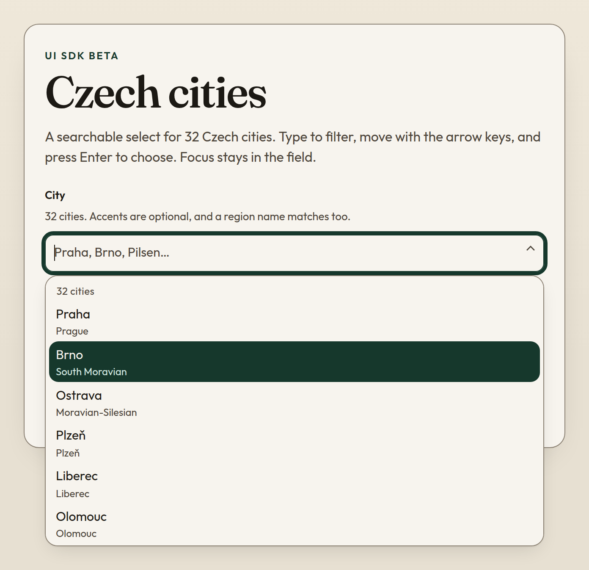

# UI SDK typeahead demo

A small public demo of the [Vercel UI SDK](https://github.com/vercel-labs/ui) beta: one searchable select for 32 Czech cities.

The control is the Combobox from `@ui-sdk/react` 0.1.0-beta.1. Behavior, ARIA, and the optional `web.css` theme come from `@ui-sdk/core` at the same version. Type to filter (accents are optional, and a region or exonym matches too), move with the arrow keys, and press Enter to choose. Focus stays in the field. The highlighted option is exposed with `aria-activedescendant`.

UI SDK is in beta. The API, docs, and behavior can change before general availability. This repository is a demo, not a supported component library.



## Run

```bash
npm install
npm run dev
```

Vite `base` is `/ui-sdk-typeahead-demo/`, including in dev, so open [http://localhost:5173/ui-sdk-typeahead-demo/](http://localhost:5173/ui-sdk-typeahead-demo/).

```bash
npm test
npm run build
npm run preview
```

The preview server uses the same base path: [http://127.0.0.1:4173/ui-sdk-typeahead-demo/](http://127.0.0.1:4173/ui-sdk-typeahead-demo/).

## Pages preview

Pushes to `cursor/ui-sdk-typeahead-demo-5d62` run [`.github/workflows/gh-pages.yml`](.github/workflows/gh-pages.yml). The workflow builds the site and publishes `dist` to the `gh-pages` branch with [peaceiris/actions-gh-pages](https://github.com/peaceiris/actions-gh-pages). The intended URL is [https://onfiala.github.io/ui-sdk-typeahead-demo/](https://onfiala.github.io/ui-sdk-typeahead-demo/).

## Docs

- UI SDK: [https://ui-sdk.dev/docs](https://ui-sdk.dev/docs)
- Combobox: [https://ui-sdk.dev/docs/react/components/combobox](https://ui-sdk.dev/docs/react/components/combobox)
- Source: [https://github.com/vercel-labs/ui](https://github.com/vercel-labs/ui)

`BUILD_LOG.md` records what the agent did against the installed beta packages, what worked the first time, and what did not.
